<p align="center">
  
</p>

<p align="center">
  <a href="https://github.com/AdityasahuX07/Dim"></a>
  <a href="https://kotlinlang.org"></a>
  <a href="https://developer.android.com/jetpack/compose"></a>
  <a href="https://buymeacoffee.com/adityasahu"></a>
</p>

<p align="center">
  <b>Dim</b> is a thoughtful, privacy-first companion crafted to help you understand, track, and manage migraines and chronic headaches.
</p>

Built with a **beautiful, modern, and minimal dark UI**, Dim is purposefully designed to be gentle on photosensitive eyes during painful flare-ups. It makes logging migraine episodes **effortless and quick**—record an attack in just a few gentle taps, track ongoing sessions in real-time, visually map head and back pain, and note symptoms, medications, and triggers. By correlating passive health signals like sleep and heart rate, Dim helps uncover hidden patterns behind your headaches and exports clean, comprehensive reports ready for your doctor—all while keeping your personal health data completely private on your device.

## Features

- **Comprehensive Episode Logging**: Track migraine severity, onset, duration, and ongoing sessions.
- **Visual Pain Mapping**: Interactive head and back pain mapping.
- **Trigger & Symptom Tracking**: Log sensory sensitivities, aura, nausea, hydration, caffeine, meals, sleep, and weather factors.
- **Health Connect Integration**: Correlate episodes with passive health data including sleep stages, resting heart rate, and step count.
- **AI Insights**: Intelligent pattern detection and insights powered by Gemini.
- **Doctor Reports**: Export detailed episode summaries and clinical PDF reports to share with healthcare providers.
- **Local-First & Private**: Data stays on your device with encrypted backup/restore support.

## 📸 Screenshots

<p align="center">
  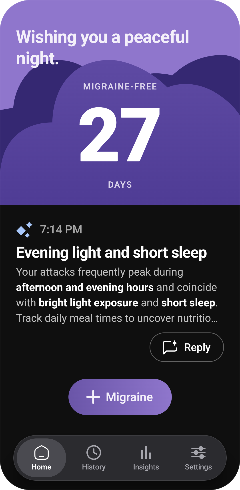
  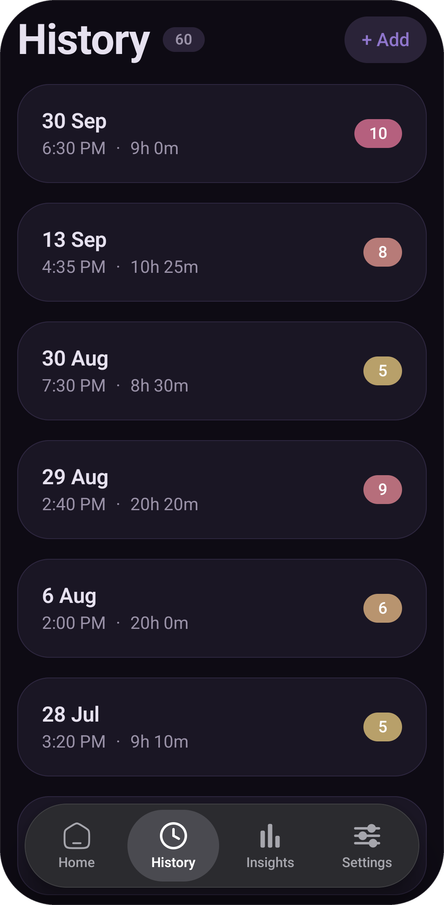
  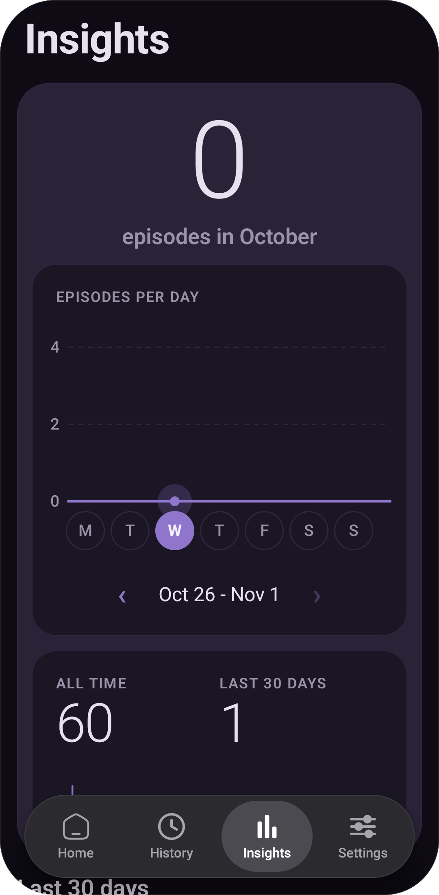
</p>
<p align="center">
  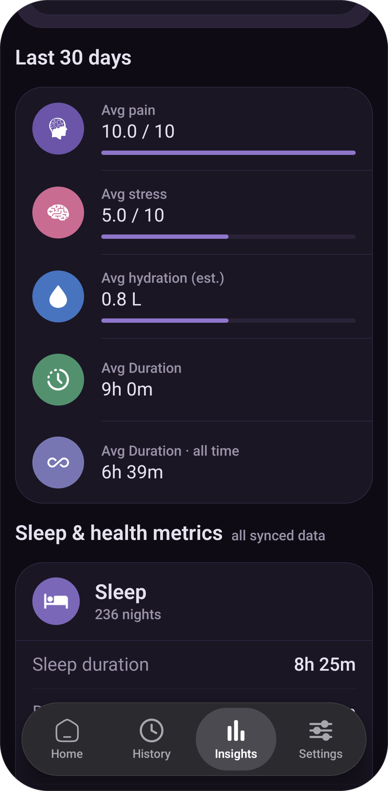
  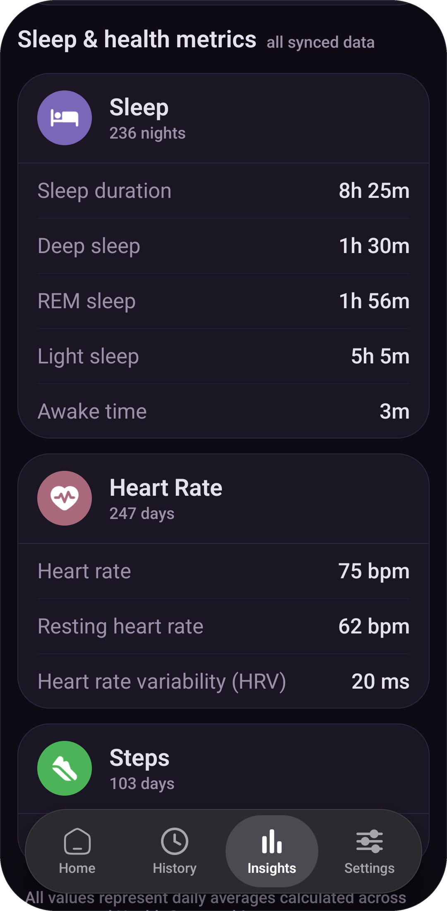
  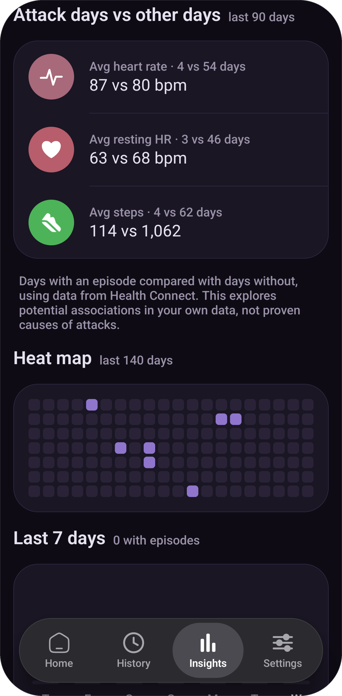
</p>
<p align="center">
  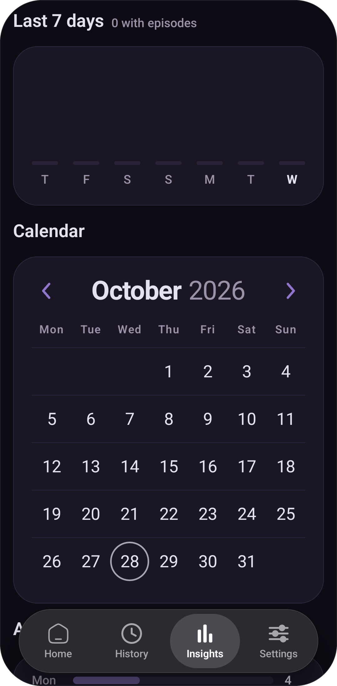
  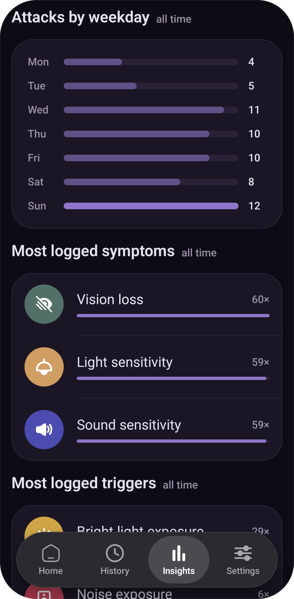
  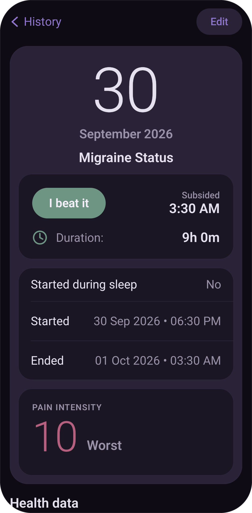
</p>
<p align="center">
  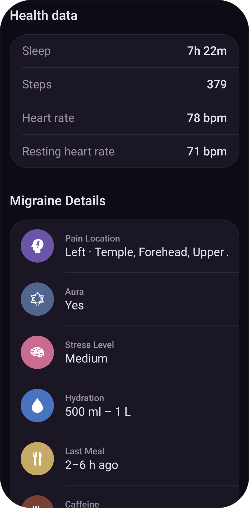
  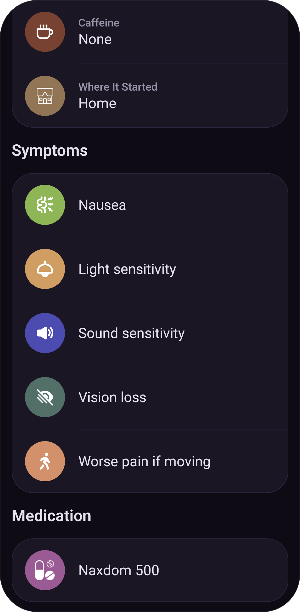
</p>

## Tech Stack

- **UI**: Android Jetpack Compose (100% Kotlin)
- **Architecture**: Single-activity, modern Android architecture
- **Persistence**: Room Database (SQLite) with Kotlin Coroutines & Flow
- **Health**: Android Health Connect API
- **Build System**: Gradle Kotlin DSL (`.gradle.kts`)

## Getting Started

### Prerequisites

- Android Studio Ladybug | 2024.2.1 or newer
- JDK 17
- Android SDK 36 (minSdk 26, targetSdk 35)

### Building from Source

1. Clone the repository:
   ```bash
   git clone https://github.com/AdityasahuX07/Dim.git
   cd Dim
   ```

2. Open the project in Android Studio or build using the Gradle wrapper:
   ```bash
   ./gradlew assembleDebug
   ```

## ☕ Support

<p align="center">
  If you find this project helpful, consider supporting its development:
</p>

<p align="center">
  <a href="https://buymeacoffee.com/adityasahu">
    
  </a>
</p>

## License

This project is licensed under the terms of the license included in the repository.
